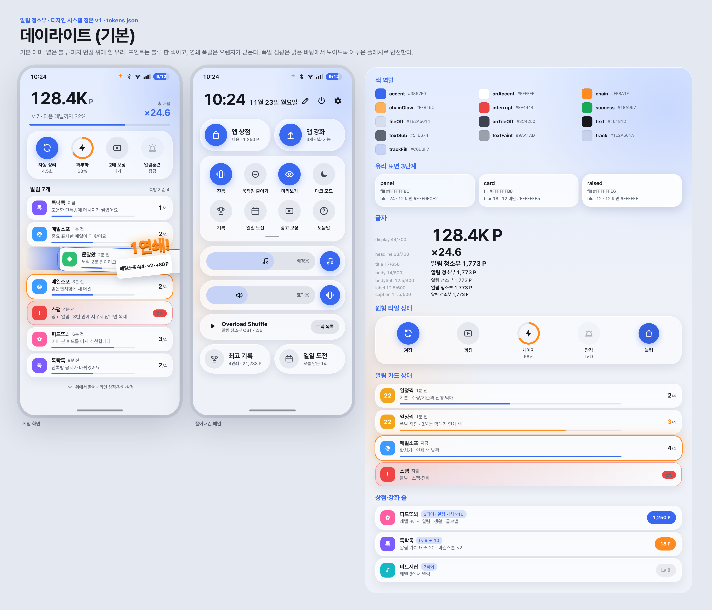
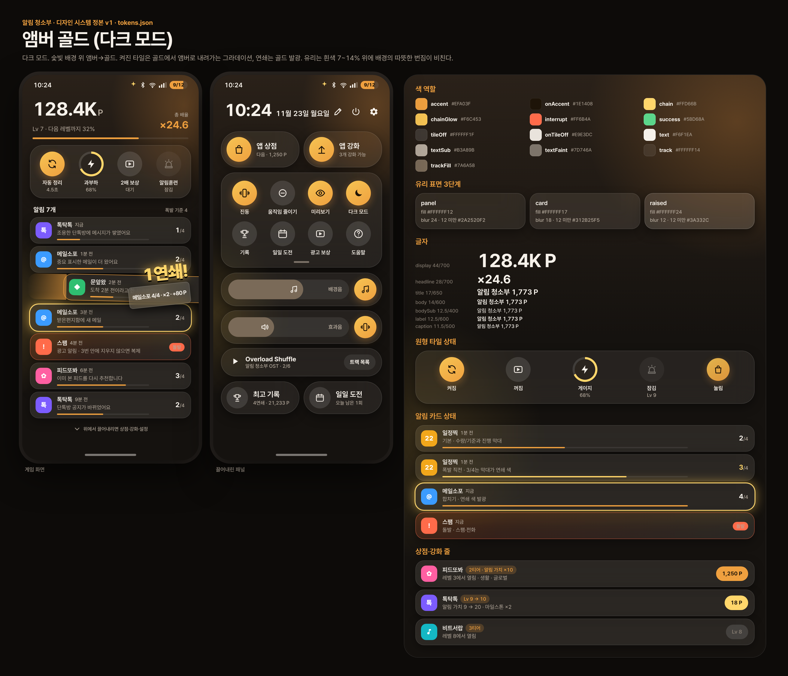

# 알림 청소부 디자인 시스템 v1

2026-11-23 · 정본 · 값의 원본은 [`tokens.json`](tokens.json)이다. 이 문서와 시트는 그 값을 설명하고 렌더링한 것이다.

| 데이라이트 (기본) | 앰버 골드 (다크 모드) |
|---|---|
|  |  |

```sh
cd docs/design/theme-source && npm install && node ds.js && node shot.js 2 ds-light ds-dark
```

## 1. 원칙

1. **안드로이드처럼 읽히고, 게임처럼 반응한다.** 상태표시줄·빠른 설정·알림 카드의 문법을 그대로 쓴다. 대기 상태는 차분하고, 강한 색과 움직임은 입력과 결과에만 쓴다.
2. **켜진 것 = 보상이 붙은 것.** 포인트 색은 켜진 타일, 진행 막대, 사는 버튼에만 쓴다. 꺼짐·잠김은 무채색이다.
3. **연쇄 색은 따로 있다.** 합치기 발광, 폭발 직전 막대, 연쇄 문구, 과부하 게이지는 연쇄 색(라이트 오렌지, 다크 골드)을 쓴다. 포인트 색과 섞지 않는다.
4. **유리는 배경이 있어야 보인다.** 모든 화면 배경에 두 개의 색 번짐을 깐다. 유리는 그 번짐을 흐리게 비친다.
5. **실제 브랜드를 흉내 내지 않는다.** 통신사명·제조사 로고·실제 앱 이름과 아이콘은 쓰지 않는다. 가상 앱은 자체 이름, 색, 글리프를 쓴다.

## 2. 모드

| | 데이라이트 (기본) | 앰버 골드 (다크 모드) |
|---|---|---|
| 배경 | `#E3ECFF → #EEF1F7`, 번짐 블루·피치 | `#2A2119 → #15120F`, 번짐 앰버·골드 |
| 포인트 | 블루 `#3867F0`, 위 글자 흰색 | 앰버 `#EFA03F`. 켜진 타일은 골드 `#F6C453` → 앰버 그라데이션, 위 글자 `#1E1408` |
| 연쇄 | 오렌지 `#FF8A1F`, 발광 `#FFB15C` | 골드 `#FFD66B`, 발광 `#F6C453` |
| 돌발 | `#EF4444` | `#FF6B4A` |
| 본문 / 보조 / 흐림 | `#16181D` / `#5F6674` / `#9AA1AD` | `#F6F1EA` / `#B3A89B` / `#7D746A` |
| 폭발 섬광 | **어두운** 플래시 `#0B1020` (밝은 바탕에서 반전) | 밝은 플래시 `#FFF4D6` |

시스템 다크 모드를 따르고, 끌어내린 패널의 **다크 모드** 타일로 직접 바꿀 수 있다.

## 3. 유리 표면

| 단계 | 쓰는 곳 | 라이트 채움 | 다크 채움 | 블러 |
|---|---|---|---|---:|
| panel | 빠른 설정 묶음, 큰 버튼, 슬라이더, 미디어 카드 | 흰색 55% | 흰색 7% | 24 |
| card | 알림 카드, 상점·강화 줄 | 흰색 72% | 흰색 9% | 18 |
| raised | 연쇄 설명 말풍선, 미는 중인 카드, 시트 위 강조 | 흰색 90% | 흰색 14% | 12 |

- 모든 유리는 1dp 밝은 테두리와 부드러운 그림자를 가진다(값은 토큰).
- **Android 구현** · 배경 블러는 Android 12(API 31) 이상에서 `RenderEffect` 기반 백드롭 블러로 그린다(Compose에서는 Haze 같은 Apache 2.0 라이브러리 후보). 최소 지원인 Android 8~11에서는 블러 없이 `fallbackFill`(거의 불투명한 같은 색)로 그린다. 두 경우 모두 테두리·그림자는 같다.
- 프레임 예산을 지키기 위해 블러 레이어는 화면당 패널 단위로 묶는다. 알림 카드 7장을 각각 블러하지 않고, 카드 목록 뒤에 한 장의 블러 레이어를 둔 뒤 카드는 채움만 그리는 방식을 먼저 프로파일링한다.

## 4. 글자

글꼴은 **Pretendard**(SIL OFL 1.1)를 앱에 넣는다. 숫자는 고정폭 숫자(`tnum`)로 그려 P와 배율이 바뀔 때 흔들리지 않게 한다.

| 역할 | 크기/줄 | 굵기 | 쓰는 곳 |
|---|---|---:|---|
| display | 44/48 | 700 | P 지갑, 패널 시계 |
| headline | 28/34 | 700 | 총 배율, 결과 숫자 |
| title | 17/22 | 650 | 큰 버튼 제목, 시트 제목 |
| body | 14/20 | 600 | 알림 앱 이름 |
| bodySub | 12.5/18 | 400 | 알림 내용 |
| label | 12.5/16 | 600 | 원형 타일 이름, 버튼 |
| caption | 11.5/14 | 500 | 시간, 보조 수치 |
| combo | 40/40 | 900 | 연쇄 문구 (연출 전용) |

큰 글자 설정(최대 200%)에서 display·headline은 85%까지 줄이고, 카드는 높이가 늘어나도록 한다.

## 5. 형태와 간격

- 반경: 원형 타일·알약 버튼 완전 원형, 알림 카드 20, 패널 30, 시트 32, 앱 아이콘 12, 칩 10.
- 간격은 4의 배수(4·8·12·16·20·24). 화면 좌우 여백 18.
- 크기: 원형 타일 58(작은 타일 50), 알림 카드 높이 62, 앱 아이콘 38, 상태표시줄 42, 슬라이더 46. 모든 조작 영역은 최소 48.

## 6. 컴포넌트

| 컴포넌트 | 상태 | 규칙 |
|---|---|---|
| **상태표시줄 HUD** | — | 시계는 실제 시각. 배터리 = 행동력(`9/12`, 포인트 색 채움). 신호 막대 4칸 = 과부하 게이지 25%씩. 반짝이 = 이벤트·부스트 진행 중(연쇄 색) |
| **원형 타일** | 켜짐 · 꺼짐 · 게이지 · 잠김 · 눌림 | 켜짐은 포인트 채움과 그림자. 게이지는 연쇄 색 원호. 잠김은 38% 불투명과 해금 조건 한 줄. 눌림은 92% 축소, 90ms |
| **큰 알약 버튼** | 기본 · 알림 | 원형 아이콘 + 제목 + 한 줄. 할 수 있는 일이 있으면 한 줄에 숫자를 쓴다("3개 강화 가능") |
| **알림 카드** | 기본 · 폭발 직전 · 미는 중 · 합치기 · 돌발 | 오른쪽에 `수량/기준`, 아래 진행 막대. 기준 1개 전이면 막대·숫자가 연쇄 색. 미는 중은 raised 유리, 포인트 테두리, 왼쪽 잔상. 합치기는 연쇄 색 2dp 테두리와 발광. 돌발은 돌발 색 테두리·칩 |
| **연쇄 문구** | — | combo 글자, 연쇄 색, -6° 기울기. 아래 raised 말풍선에 이유 하나: `메일소포 4/4 · ×2 · +80 P` |
| **슬라이더** | — | 밝기 자리 = 배경음, 볼륨 자리 = 효과음. 오른쪽 원형 타일은 음소거·진동 토글 |
| **미디어 카드** | 재생 · 정지 | 배경음 트랙. "트랙 목록" 버튼 |
| **상점·강화 줄** | 살 수 있음 · 마일스톤 · 잠김 | 칩에 티어 또는 `Lv 9 → 10`, 한 줄에 바뀌는 가치. 마일스톤 직전 강화는 연쇄 색 버튼. 잠김은 무채색 버튼에 해금 레벨 |

## 7. 움직임과 타격감

- UI: 탭 90ms, 토글 160ms, 패널 열기 320ms, 카드 등장 220ms. 스프링 감쇠 0.72, 강성 520.
- 판정 박자와 히트스톱: 합치기 24ms, 폭발 40ms, 과부하 55ms, 붕괴 85ms(시연판 가설 유지, 그레이박스에서 실기기 검증).
- 데이라이트에서 폭발 섬광은 화면을 어둡게 한 번 뒤집는다(`flash`). 다크에서는 밝은 크림색 섬광.
- 움직임 줄이기: 흔들림·섬광·파티클을 끄고 연쇄 문구는 고정 위치에 표시한다. 소리·진동은 각각 따로 끈다.

## 8. 접근성

- 본문·보조 글자는 각 모드의 기본 배경과 유리 위에서 대비 4.5:1 이상을 목표로 하고, 그레이박스 단계에서 실측한다. 흐림 글자(`textFaint`)는 장식·보조 숫자에만 쓴다.
- 색만으로 상태를 전하지 않는다. 폭발 직전은 숫자로, 돌발은 칩 글자로, 잠김은 해금 조건 글자로 함께 표시한다.
- TalkBack: 알림 카드에 "메일소포, 2 / 4, 옆으로 밀어 정리" 같은 설명과 정리 동작을 단다. 판정은 스와이프와 같은 경로를 쓴다.
