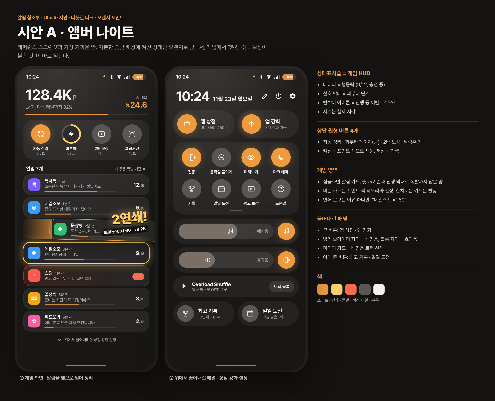
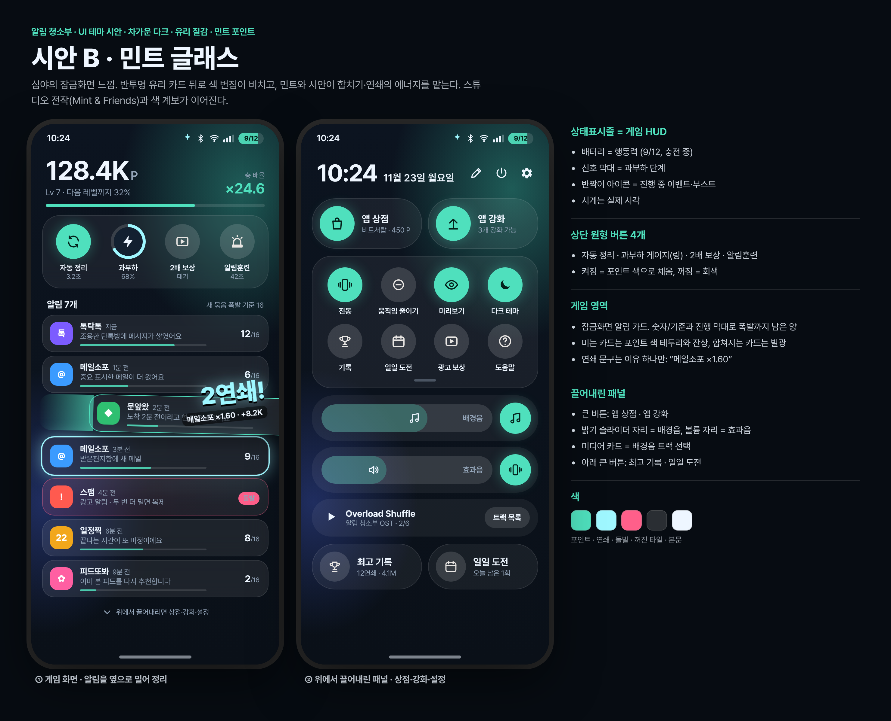
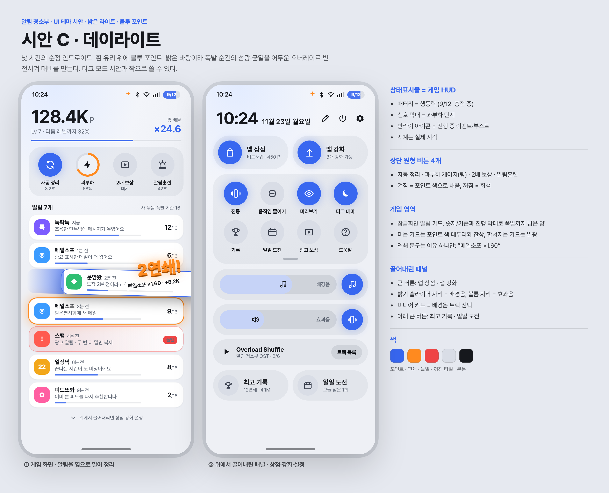

# 알림 청소부 UI 테마 시안

2026-11-23 · 본편 UI는 시연 앱을 잇지 않고 새로 설계한다. 이 시안 중 하나를 고르면 앱 전체 테마의 정본(색·형태·글꼴·컴포넌트)으로 삼는다.

| 시안 A · 앰버 나이트 | 시안 B · 민트 글래스 | 시안 C · 데이라이트 |
|---|---|---|
|  |  |  |
| 따뜻한 다크, 오렌지 포인트. 레퍼런스와 가장 가까움 | 차가운 다크, 유리 질감, 민트 포인트 | 밝은 라이트, 블루 포인트. 다크 시안과 짝으로 사용 가능 |

## 세 시안이 공유하는 화면 구조

1. **상태표시줄 = 게임 HUD.** 시계는 실제 시각, 배터리는 행동력(9/12, 충전 중), 신호 막대는 과부하 단계, 반짝이 아이콘은 진행 중인 이벤트·부스트를 뜻한다.
2. **헤더.** 큰 숫자는 P 지갑, 아래에 레벨과 XP 막대, 오른쪽에 현재 총 배율을 둔다.
3. **상단 원형 버튼 4개.** 자동 정리, 과부하 게이지(링), 2배 보상, 알림훈련. 켜진 버튼은 포인트 색으로 채우고 꺼진 버튼은 회색이다.
4. **게임 영역 = 잠금화면 알림 목록.** 카드마다 `수량/폭발 기준`과 진행 막대가 있다. 미는 카드는 포인트 색 테두리와 잔상, 합쳐지는 카드는 발광으로 표시한다. 연쇄 문구는 이유 하나만 보여 준다.
5. **위에서 끌어내린 패널 = 게임 메뉴.** 앱 상점·앱 강화 큰 버튼, 토글 8개(진동, 움직임 줄이기 등), 밝기 슬라이더 자리에 배경음, 볼륨 자리에 효과음, 미디어 카드는 배경음 트랙, 아래 큰 버튼은 최고 기록과 일일 도전이다.

## 정본으로 정할 때 같이 확정할 것

- 글꼴: Pretendard(OFL). 시안 렌더링에 사용했고 앱에 번들할 수 있다.
- 형태: 원형 타일 58dp, 큰 알약 버튼, 카드 반경 20dp, 패널 반경 30~32dp. 조작 영역은 최소 48dp.
- 색 역할 5개: 포인트, 연쇄(발광·연쇄 문구), 돌발(스팸·전화), 꺼진 타일, 본문. 시안 보드의 색 견본 순서와 같다.
- 실제 제조사 UI를 흉내 내지 않는다. 통신사명·제조사 로고·실제 앱 이름은 쓰지 않고, 안드로이드 공통 문법(상태표시줄, 빠른 설정, 알림 카드)만 빌린다.

시안은 `theme-source`에서 다시 렌더링한다(`npm install && node gen.js && node shot.js 2`).
